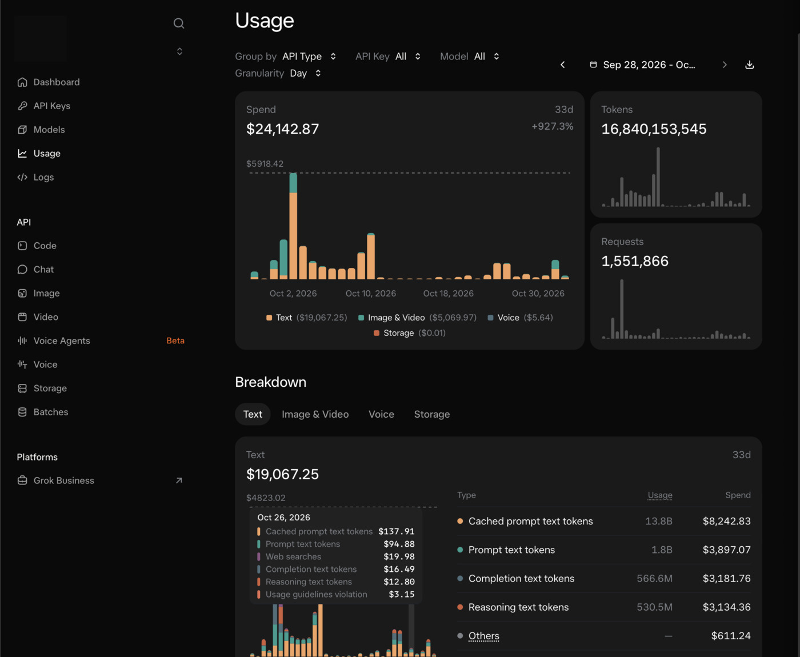

---

## Production usage

xAI console, **28 Sep 2026 – 30 Oct 2026**. Team id and account name are redacted. The right-hand window from the original capture is not included.

| Tokens | Requests | Cached prompt share |
|---|---|---|
| **16.84B** | **1.55M** | **88.5%** |

Cached prompt tokens were 13.8B. Uncached prompt tokens were 1.8B. 13.8 / 15.6 = 88.5%. Text spend on the same export was $19,067 of $24,143.

Architecture for the systems behind this bill: **[system-design-portfolio](https://github.com/web3-ai-game/system-design-portfolio)**.

---

## About

I design and run multi-model chat gateways, a self-hosted Grok client, Telegram bots, and reversible VPS blue-team tooling.

Languages in production: Go, Python, TypeScript, JavaScript, Bash. Deploy path is usually a single binary or a container, behind Cloudflare, with secrets injected at runtime and kept out of the browser.

公開作品都在下面。私有系統的架構、SSE 併發、專家議會與用量記帳寫在 [system-design-portfolio](https://github.com/web3-ai-game/system-design-portfolio)，原始碼不開放。

---

## Stack

---

## Pinned work

<table>
<tr>
<td width="50%">

### [system-design-portfolio](https://github.com/web3-ai-game/system-design-portfolio)

Architecture and benchmarks for the private production systems: multi-model SSE gateway, MoE expert council, Cursor-to-xAI gateway, interpreter bot.

No source. Diagrams and numbers only.

</td>
<td width="50%">

### [vps-guard](https://github.com/web3-ai-game/vps-guard)

Tails `auth.log` and nginx, bans through UFW, sends Telegram alerts, and gates the ops panel behind a PIN.

</td>
</tr>
<tr>
<td width="50%">

### [ebook-to-md](https://github.com/web3-ai-game/ebook-to-md)

Ebook to Markdown with OCR, LLM structure detection, resume, and dedup. The repo notes **5,153** documents processed.

</td>
<td width="50%">

### [chat-distill-pipeline](https://github.com/web3-ai-game/chat-distill-pipeline)

Pulls local and cloud files, distills at low temperature, redacts, and exports JSONL for a vector store.

</td>
</tr>
<tr>
<td width="50%">

### [eldercare-ai-bot](https://github.com/web3-ai-game/eldercare-ai-bot)

Two Telegram bots for family eldercare. Shared memory, model routing, and a multi-model cross-check. Docker Compose.

</td>
<td width="50%">

### [NYCKING](https://github.com/web3-ai-game/NYCKING)

Translation PWA for Chinese, English, Thai, Lao, and Burmese. Voice and text. Provider keys stay on the API server.

</td>
</tr>
</table>

---

## Contract work

| Area | What I ship |
|---|---|
| AI applications | Multi-model gateways, knowledge bases, chat engines, bring-your-own-key setups |
| Gateways and quotas | OpenAI-compatible fronts, tiered quotas, per-user and per-model cost ledgers |
| Go / Python backends | Single-binary APIs, billing controls, data pipelines |
| DevSecOps | Log monitoring, auto-ban, reversible hardening, honeypot alerts |
| Telegram bots | Moderation, translation, review queues, scheduled jobs |
| Web apps | React, Next.js, Vite, Firebase, i18n |
| Automation | Shell deploy tooling, distillation pipelines, monitors |

---

DeepWeay Labs

